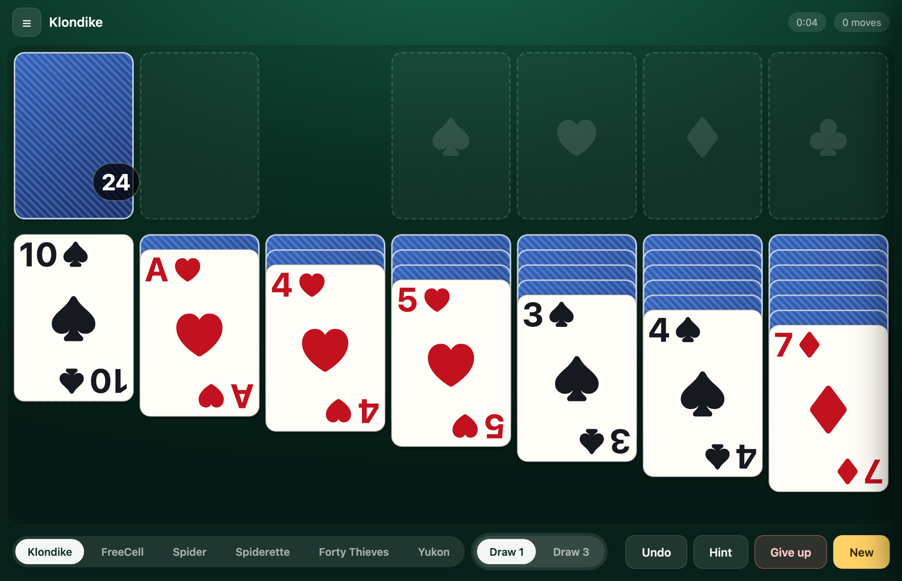

# Solitaire

Klondike, FreeCell, Spider and more — an offline, installable card game for iPad and any modern browser.

**No frameworks, no ads, no tracking, no accounts.** The whole thing is plain HTML, CSS and JavaScript.

[](https://cvanaalst.github.io/solitaire/)



---

## Play it

**[https://cvanaalst.github.io/solitaire/](https://cvanaalst.github.io/solitaire/)**

On an iPad or iPhone, open that link in Safari and choose **Share → Add to Home Screen**. It installs as a standalone, full-screen app with its own icon, and it keeps working with no connection at all.

The step-by-step guide, in English and Dutch, is in **[docs/INSTALL.md](docs/INSTALL.md)**.

There is also a single self-contained file, `dist/solitaire.html`, with everything inlined — [download it from the live site](https://cvanaalst.github.io/solitaire/dist/solitaire.html). AirDrop it to an iPad and it opens straight from the Files app: no server, no install.

## The games

| Game | Deck | The twist |
|---|---|---|
| **Klondike** | 52 cards | Draw one card at a time or three. Only a King may start an empty column. |
| **FreeCell** | 52 cards | Play with one, two or four suits, and with four or six free cells. |
| **Spider** | 104 cards | One, two or four suits. Build in a single suit, and send a whole King-to-Ace run to a foundation. |
| **Spiderette** | 52 cards | Spider with a single deck and no stock, so there is far less to juggle. |
| **Forty Thieves** | 40 cards | One deck without the eights, tens or kings. Everything starts face up. |
| **Yukon** | 52 cards | Seven long columns, no stock, and groups move whether they are in order or not. |

## The cards

There are no card images at all. Every face is drawn with CSS: a white card
with a dark edge, a large suit in the middle, and the rank and suit together
in the top left corner. That keeps the whole app small, sharp at every
screen size and consistent with itself.

Because a fanned column only shows a sliver of each covered card, the corner
index is scaled to whatever strip is still visible, so every card in a pile
can be read at a glance.

## What it does

- **Six games**, each with its own difficulty settings.
- **Tap to select, tap to place** — and drag as an alternative. Double tap sends a card straight to a foundation.
- **Legal destinations light up** when you pick a card up, so the rules teach themselves.
- **Undo** for as many moves as you like, plus a **Hint** that explains *why* a move is good.
- **Your game is saved automatically**, so closing the app mid-game loses nothing.
- **Per game statistics**: wins, win rate, streaks, fastest win, and charts of games per week, month and year.
- **Seeded deals**: every game has a code, so you can replay the exact same deal, share it with someone, or play the daily deal that everyone plays on the same day.
- **Knows when you are stuck.** The game says so when it can prove there is no way forward, and there is a **Give up** button when you want to start afresh.
- Works offline, installable, and needs no build step to play.

## Running it locally

You need Node 18 or newer for the tooling. The game itself is just static files.

```bash
npm run dev      # serve on http://127.0.0.1:8123 and open a browser
npm test         # run the test suite (72 tests, no dependencies)
npm run build    # build dist/solitaire.html and dist/site
```

No build step is needed to play. `npm run build` produces `dist/solitaire.html`,
a single self-contained file of about 120KB, and `dist/site`, the version that
is deployed.

`npm run dev` picks the next free port if 8123 is taken, and prints the address to open. To play on an iPad over Wi-Fi:

```bash
HOST=0.0.0.0 npm run dev
```

Then open the printed `http://<your-ip>:8123/` on the device. Both machines must be on the same network.

## Releasing

The version lives in `package.json`. To publish a new version:

```bash
npm version patch        # or minor, or major
git push
```

The build stamps the version and a hash of the assets into the page, so the splash screen always shows exactly which build is running — `Version 1.0.1 (3f9c2ab10e)`. The service worker cache name is derived from that same hash, so every release produces a fresh cache, and the app tells you when it has updated itself.

## Deploying

Every push to `main` runs the GitHub Actions workflow in `.github/workflows/pages.yml`, which tests the code, builds the site and deploys it to GitHub Pages. The published URL is <https://cvanaalst.github.io/solitaire/>.

To set this up on a fork:

1. **Settings → Pages → Build and deployment → Source: GitHub Actions**.
2. Push to `main` and the workflow does the rest.

The service worker cache name is derived from a hash of the built assets, so every deploy produces a fresh cache and installed copies pick up new versions on the next reload without any manual step.

## Installing on an iPad or iPhone

The full guide lives in [docs/INSTALL.md](docs/INSTALL.md), in English and Dutch. In short:

1. Open the game link in **Safari** (not Chrome, only Safari can install web apps on iOS)
2. Tap **Share**, then **Add to Home Screen**
3. Leave **Open as Web App** switched on and tap **Add**

It works offline afterwards, and it updates itself the next time you open it.

## How the code is laid out

```
index.html              the whole app shell
styles.css              every style, including the cards, which are drawn in CSS
manifest.webmanifest    the PWA manifest
sw.js                   the service worker: network first, cache fallback, offline
src/
  main.js               wiring: state, HUD, statistics, splash screen, keyboard
  engine.js             the rules: legal moves, undo, redeal, run detection, analysis
  variants.js           each game as a data spec: deck, columns, rules, difficulty
  layout.js             responsive geometry, computed from the viewport
  render.js             the DOM renderer, card elements, deal animation
  input.js              pointer handling: tap, drag, double tap
  cards.js              the deck, suits, ranks, shuffling
  rules.js              the rules text and the how-to-play copy
  stats.js              statistics aggregation for the charts
  deals.js              seed encoding, share links, the daily deal
  persist.js            IndexedDB storage for saves and statistics
tests/                  the test suite, run with node --test
tools/
  build.mjs             builds the single file and the deployable site
  dev-server.mjs        the local server
  make_icons.py         regenerates the app icons
```

The engine knows nothing about the DOM and the renderer knows nothing about the rules. Adding a game means adding a spec to `src/variants.js` and, if it needs a new rule, one flag to the engine.

## Browser support

Built for iOS 16 and later, and it works in any current version of Safari, Chrome, Edge or Firefox. The layout is computed from the viewport, so it fills an iPad, a phone or a desktop window without any breakpoints.

## Credits

Designed by **Butch**. The cards and the card backs are drawn entirely in
CSS, so there is no artwork to credit and nothing extra to download.
